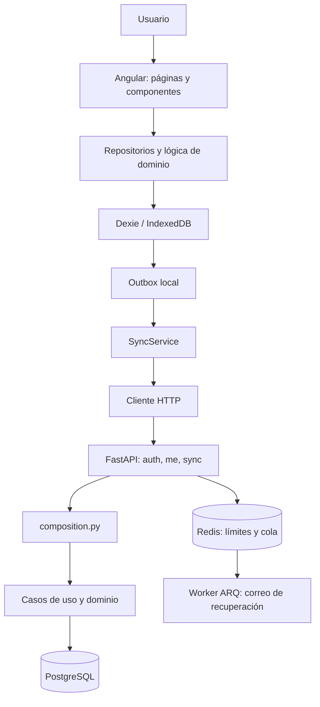

# Documentación técnica del MVP de Finanzas

## 1. Resumen del backend y frontend

**Backend.** API asíncrona en FastAPI para registro e inicio de sesión, sesiones, recuperación de contraseña, perfil y sincronización de datos. Los módulos de categorías, movimientos, recurrencias y presupuestos exponen sus operaciones al cliente mediante la API de sincronización, no mediante endpoints CRUD individuales. La aplicación y sus routers se conectan en backend/app/main.py; la composición de casos de uso está en backend/app/composition.py.

**Frontend.** PWA Angular para finanzas personales. Sus áreas incluyen resumen, movimientos, categorías, recurrentes, presupuestos, gráficos, ajustes y autenticación; las rutas están en src/app/app.routes.ts. Guarda datos en IndexedDB mediante Dexie y sincroniza con el backend. Las escrituras locales y su inclusión en la cola de salida se realizan en una transacción conjunta mediante src/app/core/local-store.ts.

**Límites identificados.**

- El envío productivo de correo de recuperación no está integrado: el adaptador actual registra el enlace en logs. Véanse backend/app/modules/auth/infrastructure/mailer.py y backend/app/worker.py.
- El frontend implementa el cálculo y generación local de ocurrencias recurrentes; el backend almacena y sincroniza las reglas y movimientos, pero no se identificó un worker de recurrencias en el servidor. Véanse src/app/features/recurrentes/data/rule.repo.ts y src/app/layout/shell.ts.
- El README del frontend señala dos diferencias frente al blueprint: no hay gesto de deslizar para eliminar en el historial y tocar una etiqueta no abre el historial filtrado. Véase `README.md`.

## 2. Tecnologías y dependencias

Las versiones que siguen son las declaradas en los manifiestos. Cuando se expresa un rango, no se afirma una versión exacta instalada.

| Área | Tecnología o dependencia | Uso |
|---|---|---|
| Backend | Python `>=3.12` | Lenguaje y versión mínima declarada. |
| Backend | FastAPI `>=0.143.0`, Uvicorn `>=0.54.0` | API HTTP y servidor ASGI. |
| Backend | Pydantic `>=2`, pydantic-settings `>=2.15.0` | Validación de datos y carga de configuración. |
| Backend | SQLAlchemy asyncio `>=2`, asyncpg `>=0.32.0` | Acceso asíncrono a PostgreSQL. |
| Backend | Alembic `>=1.20.0` | Migraciones de esquema. |
| Backend | Redis `>=5.3.1`, ARQ `>=0.28.0` | Redis se utiliza para rate limiting y cola de tareas; ARQ ejecuta el worker de correo. |
| Backend | PyJWT `>=2.15.1`, pwdlib con Argon2 `>=0.3.1` | Tokens JWT y hash/verificación de contraseñas. |
| Backend | pytest, pytest-asyncio, pytest-cov, Ruff, mypy | Pruebas, cobertura, lint y análisis de tipos. |
| Frontend | Angular `^22.2.0`, Angular CLI/build `^22.2.x` | Aplicación web y compilación. |
| Frontend | TypeScript `~6.0.2`, RxJS `~7.8.0` | Lenguaje y flujos reactivos. |
| Frontend | Dexie `^4.4.6` | Persistencia local sobre IndexedDB. |
| Frontend | Angular Service Worker | Caché de aplicación PWA en producción. |
| Frontend | ECharts `^6.1.0`, ngx-echarts `^22.0.0` | Gráficos. |
| Frontend | UUID `^14.0.3` | Identificadores; UUID v5 para ocurrencias recurrentes. |
| Frontend | Vitest `^5.0.0`, fake-indexeddb `^6.2.5` | Pruebas y simulación de IndexedDB. |

Evidencia: backend/pyproject.toml, `package.json` y `angular.json`.

## 3. Arquitectura

El backend está organizado como monolito modular con capas `api`, `application`, `domain` e `infrastructure` en `auth`, `budgets`, `categories`, `recurring`, `sync` y `transactions`. La sesión de base de datos y utilidades comunes viven en `shared`. `composition.py` conecta módulos y adaptadores sin exponer repositorios de infraestructura de un módulo a otro.

El frontend separa `core` (sesión, cliente HTTP, base local y sincronización), `shared`, `layout` y módulos de funcionalidad bajo `features`. La configuración del proveedor HTTP, interceptor, router y service worker está en src/app/app.config.ts.



En el frontend, el proceso de sincronización envía primero el outbox y luego solicita cambios nuevos paginados por versión. Véase src/app/core/sync.service.ts. PostgreSQL asigna la versión de sincronización mediante una secuencia y triggers, según backend/app/shared/db.py y la migración `0001_esquema_inicial.py`.

## 4. Flujo de ejecución y procesamiento

**Arranque.** `src/main.ts` llama a `bootstrapApplication` con `appConfig`. El inicializador carga el tema y ejecuta `AuthService.init()`: recupera la cuenta local y prueba renovar la sesión. Si no hay conexión y existe una cuenta local, habilita el uso de la sesión previamente almacenada. Evidencia: src/main.ts, src/app/app.config.ts, src/app/core/auth.service.ts.

**Escritura y sincronización.**

1. La vista delega la operación en un repositorio.
2. `LocalStore` modifica la tabla local, marca el registro como pendiente y agrega el cambio al outbox dentro de una transacción Dexie.
3. `SyncService` intenta sincronizar al arrancar, al recuperar conexión, al volver a una pestaña visible y cada 60 segundos.
4. `POST /sync/push` valida los cambios, los procesa por usuario y devuelve los aplicados y rechazados. Los errores de un cambio pueden devolverse en `rejected` sin invalidar el lote completo.
5. `GET /sync/pull` entrega cambios posteriores a la versión solicitada; el cliente los aplica sin sobrescribir cambios locales pendientes o rechazados.

Fuentes principales: src/app/core/local-store.ts, src/app/core/sync.service.ts, backend/app/modules/sync/api/router.py y backend/app/modules/sync/infrastructure/handlers.py.

**Autenticación.** El backend devuelve access tokens bearer y establece el refresh token en una cookie `HttpOnly` con ruta `/auth`. El interceptor Angular agrega el bearer token y, ante un `401`, intenta una renovación compartida antes de reintentar la petición. Véanse backend/app/modules/auth/api/router.py y src/app/core/auth.interceptor.ts.

**Servicios externos.** El backend usa PostgreSQL y Redis. ARQ encola el correo de recuperación. El adaptador disponible no envía correo: escribe el enlace en logs y el worker impide arrancar con `COOKIE_SECURE` activado mientras falte un proveedor real. No se identificaron integraciones de IA.

## 5. API

Todas las rutas HTTP están registradas en backend/app/main.py, backend/app/modules/auth/api/router.py y backend/app/modules/sync/api/router.py. Salvo indicación distinta, los cuerpos inválidos producen errores de validación `422`. El manejo general de errores de dominio está en `main.py`: normalmente `422`, `401` para errores de autenticación y `429` para límite de solicitudes.

| Método | Ruta | Propósito | Parámetros o cuerpo | Respuesta | Errores identificados |
|---|---|---|---|---|---|
| `POST` | `/auth/register` | Registrar una cuenta e iniciar sesión. | `email`, `password`, `password_confirmation`; `currency` opcional. | `201`: access token, tipo de token y usuario; establece cookie refresh. | `422` por validación o regla de dominio, por ejemplo correo duplicado o contraseña no válida. |
| `POST` | `/auth/login` | Iniciar sesión. | `email`, `password`. | `200`: sesión y cookie refresh. | `401` credenciales incorrectas; `429` por límite; `422` por cuerpo inválido. |
| `POST` | `/auth/refresh` | Renovar la sesión. | Cookie `refresh_token`. | `200`: nueva sesión y cookie rotada. | `401` si no se acepta la cookie o la sesión. |
| `POST` | `/auth/logout` | Cerrar sesión. | Cookie `refresh_token`; query `all` opcional, predeterminada a `false`. | `204`; elimina la cookie. | No se identificó error de dominio para cookie ausente; el caso es idempotente. |
| `POST` | `/auth/password/forgot` | Solicitar recuperación de contraseña. | `email`. | `200`: mensaje genérico, sin revelar si la cuenta existe. | `422` por cuerpo inválido; el control de solicitudes puede limitar intentos. |
| `POST` | `/auth/password/reset` | Restablecer contraseña. | `token`, `password`, `password_confirmation`. | `200`: mensaje de confirmación. | `422` ante token o contraseña no válidos, o confirmación distinta. |
| `GET` | `/me` | Obtener perfil del usuario autenticado. | `Authorization: Bearer <access_token>`. | `200`: `id`, `email`, `currency`. | `401` si falta o no es válido el token. |
| `POST` | `/sync/push` | Enviar cambios locales al servidor. | `{"changes":[...]}`; máximo 500 cambios. Cada uno contiene `entity`, `op`, `id`, `data`. | `200`: listas `applied`, `rejected` y `version`. | `401` sin sesión válida; `422` si el lote no valida. Los rechazos de negocio se informan por cambio. |
| `GET` | `/sync/pull` | Descargar cambios desde una versión. | `since` entre 0 y el máximo BIGINT; `limit` entre 1 y 500. | `200`: `changes`, `next_since`, `has_more`. | `401` sin sesión válida; `422` para parámetros inválidos. |
| `GET` | `/health` | Estado básico del proceso HTTP. | Sin parámetros. | `200`: `{"status":"ok"}`. | No comprueba conexión a PostgreSQL ni Redis. |

En sync, las entidades admitidas son `category`, `recurring_rule`, `transaction` y `budget`; las operaciones son `upsert` y `delete`. Los campos de `data` dependen de la entidad y se validan en backend/app/modules/sync/infrastructure/handlers.py. Las rutas de auth se validan en backend/app/modules/auth/api/schemas.py. No se identificaron endpoints HTTP separados para CRUD de movimientos, categorías, recurrentes o presupuestos.

Ejemplo de solicitud de sincronización derivado del esquema:

```http
POST /sync/push
Authorization: Bearer <access_token>
Content-Type: application/json

{"changes":[]}
```

El contrato exportado se mantiene en backend/openapi.json. Hay pruebas de integración de auth y sync en `backend/tests/integration/`; no se identificó un router CRUD independiente que requiera cobertura.

## 6. Configuración y variables de entorno

`Settings` carga un archivo `.env` del directorio de ejecución y omite variables adicionales. La configuración del backend está en backend/app/config.py; los nombres también aparecen en backend/.env.example. No se reproducen valores.

| Variable | Propósito | Estado |
|---|---|---|
| `DATABASE_URL` | Conexión a PostgreSQL. | Opcional en configuración; tiene valor predeterminado local. |
| `REDIS_URL` | Conexión a Redis para límites y ARQ. | Opcional en configuración; tiene valor predeterminado local. |
| `JWT_SECRET` | Firma HS256 de access tokens. | Obligatoria; requiere al menos 32 caracteres. |
| `ACCESS_TOKEN_MINUTES` | Duración del access token. | Opcional; tiene valor predeterminado. |
| `REFRESH_TOKEN_DAYS` | Duración del refresh token. | Opcional; tiene valor predeterminado. |
| `COOKIE_SECURE` | Activa el atributo `Secure` de la cookie. | Opcional; valor predeterminado activo. |
| `FRONTEND_URL` | Origen CORS y base del enlace de recuperación. | Opcional; tiene valor predeterminado local. |

En frontend, la URL no se toma de una variable de entorno en ejecución: `environment.development.ts` apunta a localhost y `environment.ts` usa una URL vacía, para servir la API desde el mismo origen o mediante proxy. Véanse `environment.development.ts`, `environment.ts` y src/app/core/api.ts.

No se identificó configuración de credenciales de proveedor de correo. El worker de desarrollo no equivale a una integración productiva.

## 7. Instalación y ejecución

**Requisitos respaldados por los manifiestos y README:** Python `>=3.12`, `uv`, Node/npm y Docker Compose. No se encontró una versión mínima de Node declarada. El contenedor de desarrollo proporciona PostgreSQL 16 y Redis 7, con puertos locales configurados en `docker-compose.yml`.

Desde la raíz de `BackFinanzas`:

```bash
docker compose up -d
```

Desde `backend`:

```bash
uv sync --frozen
uv run alembic upgrade head
uv run uvicorn app.main:app
```

El punto ASGI `app.main:app` está confirmado por el código y el comando de Uvicorn aparece en el README del frontend. Hay que configurar `JWT_SECRET` localmente antes de arrancar. No guardar secretos en el repositorio.

Para ejecutar el worker de correo:

```bash
uv run arq app.worker.WorkerSettings
```

**Limitación:** con la configuración segura predeterminada, el worker falla intencionalmente al arrancar porque no hay proveedor real. En desarrollo, el adaptador solo registra el enlace.

Desde `FrontFinanzas`:

```bash
npm install
npm start
npm run lint
npm test -- --no-watch
npm run build
```

El README indica la aplicación en `http://localhost:4200` y el backend de desarrollo en `http://localhost:8000`. El frontend reemplaza `environment.ts` por `environment.development.ts` al servir o compilar en configuración development, según `angular.json`.

## 8. Pruebas

**Backend.** Desde `backend`:

```bash
uv run pytest
```

El workflow `backend.yml` además ejecuta Ruff, formato, mypy, pytest con cobertura mínima del 90 % y validación del OpenAPI exportado. Las unitarias cubren auth, categorías, presupuestos, recurrentes, movimientos, sync y utilidades compartidas. Las de integración cubren API de autenticación y sincronización, persistencia, esquema y migraciones.

**Advertencia:** el fixture tests/integration/conftest.py elimina y recrea una base `finanzas_test` en PostgreSQL local. No apuntar ese fixture a una base con datos que deban conservarse.

**Frontend.** El manifiesto define `npm test` como `ng test`; el README documenta `npm test -- --no-watch`. Hay cinco archivos de pruebas identificados: validaciones de dinero, movimientos, categorías, recurrencias y la capa offline. Esta última comprueba escrituras locales, outbox, push/pull, rechazos y generación de ocurrencias; usa un cliente API simulado. Véanse `src/app/core/offline.spec.ts` y las pruebas `*.spec.ts` bajo `features`.

## 9. Errores, seguridad y limitaciones

- El bearer token identifica al usuario para `/me` y sync; los datos sincronizables se filtran por usuario en el backend. Las pruebas de integración de auth y sync cubren flujos de API y aislamiento según sus archivos.
- Las contraseñas se procesan con Argon2 mediante `pwdlib`; JWT usa HS256. Las cookies refresh están configuradas `HttpOnly`, `SameSite=strict`, limitadas a `/auth`, y su atributo `Secure` depende de `COOKIE_SECURE`.
- CORS permite el origen de `FRONTEND_URL`, credenciales y métodos `GET`/`POST`. La implementación está en backend/app/main.py.
- Los esquemas de entrada rechazan campos extra. Los lotes de sincronización tienen máximo 500 elementos y cada cambio valida `data` según la entidad.
- El frontend conserva una copia local y muestra estado de sincronización; un cambio rechazado queda marcado localmente para su resolución. La lógica está en src/app/core/sync.service.ts.
- `GET /health` es una respuesta estática y no verifica dependencias.
- El mailer actual escribe el enlace de recuperación en logs. No se identificó configuración de TLS, despliegue, monitoreo ni un proveedor productivo de correo en los archivos inspeccionados.
- `AuthService.logout()` intenta cerrar la sesión remota, pero borra igualmente la base local si falla la petición. El flujo y sus posibles advertencias por cambios pendientes deben verificarse en la interfaz antes de depender de ellas; véase src/app/core/auth.service.ts.
- El service worker precarga recursos de la aplicación y descarga assets de forma diferida; los datos financieros se manejan mediante Dexie, no mediante una caché HTTP de API configurada en `ngsw-config.json`.

## 10. Pendientes por confirmar

1. ¿Qué proveedor de correo se usará y cómo se configurará sin exponer credenciales? ¿Cuál será la política para evitar enlaces de recuperación en logs?
2. ¿Cómo se desplegará frontend y backend en producción para que coincidan CORS, `apiUrl` y el alcance de la cookie `/auth`?
3. ¿Qué versión de Node/npm debe usarse en CI y desarrollo? El repositorio declara npm `11.19.0` como `packageManager`, pero no una versión mínima de Node.
4. ¿Se requiere una advertencia de cierre de sesión cuando hay cambios pendientes? Confirmar que la interfaz la implemente de extremo a extremo.