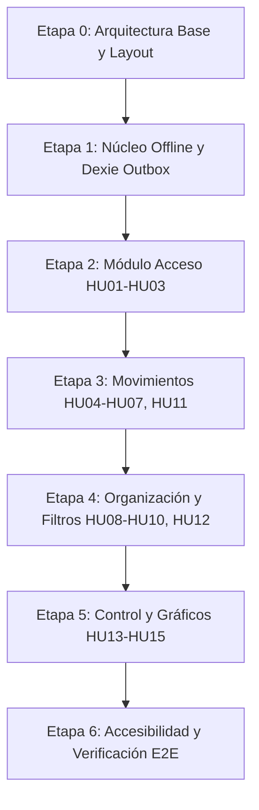

# Prompts para construir y priorizar el Blueprint de la App de Gastos Personales

## 1. Buenas prácticas aplicadas (investigadas en la web)

Fuentes: [Prompting best practices (Anthropic)](https://platform.claude.com/en/docs/build-with-claude/prompt-engineering/claude-prompting-best-practices), [Use XML tags (Anthropic)](https://platform.claude.com/docs/en/build-with-claude/prompt-engineering/use-xml-tags), [Best practices for prompt engineering (Claude)](https://www.claude.com/blog/best-practices-for-prompt-engineering), [Prompt Engineering Best Practices 2026](https://thomas-wiegold.com/blog/prompt-engineering-best-practices-2026/), [Prompt Engineering Best Practices (2026): Checklist](https://promptbuilder.cc/blog/prompt-engineering-best-practices-2026).

| Buena práctica                                  | Qué dicen las fuentes                                                                                                                   | Cómo se aplica aquí                                                                                                                                                                                     |
| ----------------------------------------------- | --------------------------------------------------------------------------------------------------------------------------------------- | ------------------------------------------------------------------------------------------------------------------------------------------------------------------------------------------------------- |
| **Etiquetas XML**                               | Separan instrucciones, contexto, ejemplos y entradas; reducen malinterpretaciones. Usar nombres consistentes y anidar si hay jerarquía. | Todos los prompts usan las mismas etiquetas: `<role>`, `<context>`, `<documents>`, `<task>`, `<instructions>`, `<constraints>`, `<examples>`, `<output_format>`, `<verification>`, `<stop_conditions>`. |
| **Asignar un rol**                              | Una sola frase en el rol ya cambia el enfoque y el tono.                                                                                | Cada prompt abre con `<role>` distinto: analista de producto, arquitecto de software, ingeniero de plataforma para agentes.                                                                             |
| **Ser claro y directo**                         | Explicar el objetivo y el _por qué_ de cada restricción; decir qué hacer, no solo qué evitar.                                           | Cada `<constraints>` lleva el motivo entre paréntesis.                                                                                                                                                  |
| **Criterios de éxito + contrato de salida**     | En 2026 el prompting es escribir una especificación: qué es "terminado", formato, longitud y secciones obligatorias.                    | `<output_format>` fija la plantilla exacta; `<verification>` lista los criterios de terminado.                                                                                                          |
| **Ejemplos (few-shot)**                         | 3–5 ejemplos relevantes y diversos dirigen el formato con mucha precisión.                                                              | `<examples>` incluye una historia modelo completa (Prompt 1), una tabla modelo (Prompt 2) y una regla modelo (Prompt 3).                                                                                |
| **Encadenar prompts**                           | Dividir una tarea grande en pasos secuenciales pasando el resultado al siguiente da más coherencia.                                     | 3 prompts en cadena, cada uno con su entregable.                                                                                                                                                        |
| **Documentos largos arriba, pregunta al final** | Poner el material extenso al inicio y la instrucción al final mejora la calidad.                                                        | `<documents>` va antes de `<task>`; la tarea cierra el prompt.                                                                                                                                          |
| **Pensar antes de responder**                   | Pedir razonamiento previo en un bloque separado mejora tareas complejas.                                                                | `<thinking>` obligatorio antes de entregar, separado del resultado.                                                                                                                                     |
| **Permiso para no saber**                       | Dar una salida ("pregunta si falta información") reduce inventos.                                                                       | `<stop_conditions>` obliga a preguntar en vez de asumir.                                                                                                                                                |
| **Autoverificación**                            | Pedir que el modelo revise su propia salida contra los criterios.                                                                       | `<verification>` con casillas que el modelo marca al final.                                                                                                                                             |
| **Contexto, no solo prompt**                    | Los fallos de agentes suelen ser de contexto: cargar solo lo necesario en cada paso.                                                    | Cada prompt recibe únicamente lo que necesita de los anteriores.                                                                                                                                        |
| **Iterar y probar**                             | Los prompts se refinan con pruebas, no salen perfectos a la primera.                                                                    | Sección 5 de este README: checklist de revisión por prompt.                                                                                                                                             |

> Nota: las fuentes indican que no existen nombres de etiqueta "canónicos" entrenados en Claude; lo importante es que sean descriptivos y consistentes.

---

## 2. Prompt 1: Historias de usuario (el QUÉ)

````xml
<role>
Eres un analista de producto senior especializado en aplicaciones de finanzas personales offline-first, con experiencia redactando historias de usuario, reglas de negocio y criterios de aceptación en Gherkin. Escribes en español claro, sin jerga innecesaria.
</role>

<context>
Vamos a documentar una app web de gastos personales que funciona sin conexión (PWA). Este documento será la fuente de verdad del producto: otros prompts y agentes de programación lo usarán para construir la app, así que cada regla debe ser precisa, comprobable y sin ambigüedades. Si una regla es vaga, el agente que programe tendrá que adivinar.
</context>

<documents>
<document index="1">
<source>Idea del producto</source>
<document_content>
App web de finanzas personales
 App web para que joven profesional, independiente o estudiante sepa cuánto entra, cuánto sale y en qué se va, registrando en segundos y cuente con graficas.
</document_content>
</document>
</documents>

<task>
Redacta las secciones 1 a 4 del Blueprint:
1. Objetivo del documento.
2. Objetivo del producto (qué podrá hacer el usuario al completar las historias).
3. Conceptos base (tabla de glosario) y actores (Usuario, Sistema).
4. Las 15 historias de usuario, organizadas en 5 módulos, con un mapa inicial (módulo, HU, historia, entrega).
</task>

<instructions>
Estructura fija de los módulos y entregas:
- Módulo 1 Acceso: HU01 Registro (R1), HU02 Inicio y cierre de sesión (R1), HU03 Recuperar contraseña (R1).
- Módulo 2 Movimientos: HU04 Registrar gasto (R1), HU05 Registrar ingreso (R1), HU06 Editar (R1), HU07 Eliminar con deshacer de 5 s (R1).
- Módulo 3 Organización: HU08 Categorías personalizadas (R1), HU09 Movimientos recurrentes (R2), HU10 Notas y etiquetas (R2).
- Módulo 4 Consulta: HU11 Historial (R1), HU12 Búsqueda y filtros (R2), HU13 Resumen mensual (R2).
- Módulo 5 Control: HU14 Presupuesto por categoría (R3), HU15 Gráficos por categoría (R3).
- R1 incluye la sincronización sin conexión desde el inicio.

Cada historia debe contener, en este orden:
a) Encabezado `#### HUxx. Título`.
b) Frase "Como / quiero / para" en bloque de cita.
c) Contexto (1-2 frases: por qué existe), cuando aporte valor.
d) Reglas de negocio numeradas. Usa tablas para campos y validaciones. Indica siempre si requiere conexión o funciona sin ella.
e) Criterios de aceptación en Gherkin en español (Escenario / Dado / Cuando / Entonces / Y), con valores concretos (montos, fechas, textos exactos de los mensajes).
f) Casos límite (doble clic, primer uso, errores del servidor).
g) Fuera de alcance, explícito.

Decisiones de producto ya tomadas (no las cambies):
- Moneda única por cuenta, ISO 4217, por defecto COP, no se cambia en el MVP; los montos son enteros en centavos.
- Sesión de 30 días sin uso; bloqueo tras 5 intentos fallidos en 15 minutos; el cierre de sesión borra los datos locales y advierte si hay cambios sin sincronizar.
- El recuperar contraseña responde siempre con el mismo mensaje; enlace de 30 min y un solo uso; máximo 3 solicitudes por hora.
- El tipo de un movimiento y el de una categoría con movimientos no se pueden cambiar.
- Borrado siempre lógico.
- Conflictos de edición: gana el último cambio que llega al servidor.
- Recurrentes: diaria, semanal, quincenal (días 15 y último), mensual (si el día no existe, último del mes), anual (29 feb pasa a 28); modos automático y con confirmación; sin duplicados entre dispositivos; máximo 366 ocurrencias por regla.
- Presupuesto: se repite cada mes; alertas al 80 % y 100 % una sola vez por mes y categoría; nunca bloquea un gasto.
- HU11, HU12, HU13 y HU15 se resuelven en el navegador con datos locales.
</instructions>

<constraints>
- Cada regla debe poder verificarse con una prueba (así el agente que programe sabe cuándo terminó).
- Usa números y textos exactos en los escenarios Gherkin, nunca "un monto" o "un mensaje" (los textos exactos se vuelven pruebas de interfaz).
- No inventes funciones fuera de las 15 historias; lo no pedido va en "Fuera de alcance" (evita que se construya de más).
- Cada historia es independiente y legible por sí sola, porque un agente leerá una sola sección a la vez.
- Mínimo 3 escenarios Gherkin por historia, incluyendo un camino feliz y un error.
</constraints>

<examples>
<example>
#### HU07. Eliminar movimiento

> **Como** usuario,
> **quiero** eliminar un movimiento equivocado, con la posibilidad de deshacerlo,
> **para** que mis cuentas reflejen solo lo que realmente pasó.

**Reglas de negocio:**
1. Se elimina desde el detalle o deslizando en el historial.
2. Aparece "Movimiento eliminado · Deshacer" durante 5 segundos.
3. La eliminación es lógica (para sincronizar el borrado).
4. Funciona sin conexión.

```gherkin
Escenario: Eliminar y deshacer
  Cuando elimino un gasto de $40.000
  Entonces desaparece del historial y el balance aumenta en $40.000
  Y cuando toco "Deshacer" antes de 5 segundos, el gasto vuelve y el balance se restablece
```

**Fuera de alcance:** papelera de reciclaje, eliminar varios movimientos a la vez.
</example>
</examples>

<stop_conditions>
Antes de redactar, si detectas una contradicción entre decisiones o un dato imprescindible que falta, lístalo como pregunta numerada y espera respuesta. No asumas.
</stop_conditions>

<output_format>
Un único documento Markdown con las secciones numeradas 1 a 4, tablas donde corresponda, y los bloques Gherkin dentro de ```gherkin. Sin texto introductorio ni despedida.
</output_format>

<verification>
Antes de entregar, razona dentro de <thinking> y comprueba, sin incluir el razonamiento en el documento final:
- [ ] Están las 15 historias, con módulo y entrega correctos.
- [ ] Cada historia tiene reglas, Gherkin (≥3 escenarios), casos límite y fuera de alcance.
- [ ] Toda regla indica si funciona sin conexión.
- [ ] Ninguna regla contradice a otra (por ejemplo, HU06 y HU08 sobre cambio de tipo).
- [ ] Los mensajes de pantalla son textos exactos y consistentes entre historias.
</verification>
````

---

## Prompt adicional: Clasificación con IA y priorización de historias

**Objetivo:** analizar únicamente las 15 historias de usuario del Blueprint y producir la clasificación por nivel de apoyo de IA, la prioridad MoSCoW y una estimación de esfuerzo/tiempo.

```xml
<role>
Eres un analista senior de producto y desarrollo de software especializado en aplicaciones web offline-first. Evalúas historias de usuario con criterio práctico, considerando la complejidad funcional, la seguridad, la sincronización cliente-servidor, el trabajo de frontend y backend, y la capacidad de una IA de programación para generar una primera implementación verificable.
</role>

<context>
El proyecto es una app web de finanzas personales llamada App de Gastos Personales. Funciona sin conexión, guarda datos localmente y los sincroniza con un backend. El Blueprint contiene exactamente 15 historias de usuario, desde HU01 hasta HU15.

La puntuación de IA mide qué tan viable es implementar la historia con apoyo de una IA de programación; no indica que el producto final deba tener inteligencia artificial. Una puntuación alta significa que la historia tiene reglas claras, patrones conocidos y código que una IA puede proponer y probar con poca intervención humana. Una puntuación baja significa que requiere mayor supervisión experta por seguridad, decisiones de arquitectura, sincronización distribuida o reglas complejas.
</context>

<documents>
<document index="1">
<source>BLUEPRINT.md</source>
<document_content>
Pega aquí el contenido completo de BLUEPRINT.md o, como mínimo, el mapa de historias y las secciones completas de HU01 a HU15.
</document_content>
</document>
</documents>

<task>
Clasifica y prioriza únicamente las historias de usuario HU01 a HU15 registradas en el Blueprint. No analices el objetivo general, el glosario, la arquitectura, la base de datos, la API ni las instrucciones para agentes como si fueran historias.

Para cada historia entrega:
1. Su identificador y título exactos.
2. Una puntuación de IA de 0 a 5.
3. Una clasificación según el rango de puntuación.
4. Una prioridad MoSCoW.
5. Una puntuación de esfuerzo/tiempo de 1 a 10.
6. Una justificación breve y específica basada en las reglas y criterios de aceptación de esa historia.
</task>

<instructions>
Usa exactamente estos rangos para la puntuación de IA:
- 0–1 puntos: historia tradicional, sin IA como apoyo principal; requiere una implementación convencional y no se beneficia especialmente de generación asistida.
- 2–3 puntos: historia híbrida; una IA puede ayudar con parte del código, pero la seguridad, la arquitectura, la sincronización o las reglas complejas requieren revisión humana importante.
- 4–5 puntos: historia implementable principalmente con IA; sus validaciones, pantallas, operaciones CRUD, cálculos o consultas siguen patrones conocidos y pueden generarse con pruebas y revisión humana.

La clasificación se refiere al proceso de desarrollo asistido por IA, no a incorporar IA dentro de la funcionalidad del producto. No asignes 0 únicamente porque una historia no use inteligencia artificial en la aplicación.

Usa MoSCoW así:
- Must: indispensable para que el núcleo de la aplicación permita registrar, proteger y consultar las finanzas.
- Should: importante para completar el uso diario, pero el producto puede funcionar temporalmente sin ella.
- Could: aporta comodidad, análisis o personalización y puede posponerse sin bloquear el núcleo.
- Won't: queda explícitamente fuera de la prioridad actual, aunque podría existir en el Blueprint.

Asigna esfuerzo/tiempo de 1 a 10 considerando el alcance completo de la historia: reglas de negocio, frontend, backend, persistencia, funcionamiento offline, sincronización, seguridad, pruebas y dependencias con otras historias. No confundas facilidad para generar código con bajo esfuerzo total.

Para evitar priorizaciones arbitrarias:
- HU01–HU03 deben considerar autenticación, sesiones, contraseñas y seguridad.
- HU04–HU07 deben considerar escritura offline, outbox, sincronización y actualización de resúmenes.
- HU08–HU10 deben considerar reglas de categorías, recurrencias, notas y etiquetas.
- HU11–HU13 deben considerar consultas locales, filtros, historial y cálculos de resumen.
- HU14–HU15 deben considerar cálculos por período, alertas y visualización.

Mantén los títulos y los identificadores del Blueprint. No inventes historias, no dividas historias, no cambies sus reglas y no agregues funcionalidades fuera de alcance.
</instructions>

<constraints>
- Deben aparecer exactamente 15 filas: una por cada historia HU01–HU15.
- La mayoría de las historias debe quedar entre 4 y 5 puntos cuando sus reglas sean convencionales y aptas para generación asistida; no fuerces puntuaciones bajas solo porque no incorporan IA al producto.
- Las historias con autenticación avanzada, sincronización distribuida o reglas temporales complejas pueden quedar en 2–3 puntos si la justificación lo demuestra.
- No uses una puntuación de esfuerzo/tiempo como sustituto de la puntuación de IA: son dimensiones independientes.
- Prioriza el núcleo funcional antes que las funciones de análisis o personalización.
- Si falta una historia, hay una contradicción o el Blueprint no permite justificar una puntuación, detente y formula preguntas concretas antes de completar la tabla.
</constraints>

<output_format>
Devuelve únicamente Markdown con estas secciones:

### Criterio utilizado
Explica en un párrafo la diferencia entre puntuación de IA, prioridad MoSCoW y esfuerzo/tiempo.

### Clasificación y priorización
Incluye una tabla con las columnas: HU, Historia, Puntos IA, Clasificación, MoSCoW, Esfuerzo/tiempo (1–10) y Justificación.

### Resumen
Indica cuántas historias quedaron en cada rango de IA y cuántas en cada categoría MoSCoW. Confirma que se analizaron exactamente HU01–HU15.
</output_format>

<verification>
Antes de entregar, revisa internamente:
- [ ] Hay exactamente 15 historias y están todas las HU01–HU15.
- [ ] Cada puntuación de IA coincide con su rango y clasificación.
- [ ] La mayoría está entre 4 y 5 cuando el código sigue patrones conocidos.
- [ ] Las justificaciones mencionan aspectos concretos de cada historia.
- [ ] MoSCoW refleja dependencia e importancia funcional, no solo el orden original de entregas.
- [ ] El esfuerzo considera frontend, backend, offline, sincronización y pruebas cuando corresponda.
- [ ] No se analizaron secciones del Blueprint que no sean historias de usuario.
</verification>
```

---

## 3. Prompt 2: Arquitectura y base de datos (el CON QUÉ y DÓNDE)

**Objetivo:** producir el stack, estilo arquitectónico, módulos, modelo de datos (servidor y navegador), reglas de sincronización, API y organización del frontend.

````xml
<role>
Eres un arquitecto de software senior con experiencia en sistemas offline-first, sincronización cliente-servidor, PostgreSQL, FastAPI y Angular. Justificas cada decisión técnica con el requisito que la origina, y prefieres la solución más simple que cumpla.
</role>

<context>
Ya existe la especificación funcional de la app de gastos personales (historias, reglas y criterios de aceptación). Ahora debes diseñar la arquitectura que la haga posible. El resultado será la fuente de verdad técnica: los agentes de programación crearán migraciones, endpoints y repositorios a partir de él, así que los nombres de tablas, columnas, tipos y restricciones deben ser exactos.
</context>

<documents>
<document index="1">
<source>Historias de usuario (salida del Prompt 1)</source>
<document_content>
{{SALIDA_PROMPT_1}}
</document_content>
</document>
</documents>

<task>
Redacta las secciones 5 y 6 del Blueprint:
5. Stack tecnológico (tabla: área, tecnología, por qué).
6. Arquitectura:
   6.1 Estilo y diagrama de bloques en ASCII (navegador, API, PostgreSQL, Redis, worker).
   6.2 Módulos del backend y las historias que resuelve cada uno; indica qué historias se resuelven solo en el navegador.
   6.3 Modelo de datos: diagrama ER en Mermaid, columnas comunes de tablas sincronizables, una tabla por entidad del servidor (tipo, restricciones, índices), esquema de la base del navegador, tablas y claves exclusivas del navegador, y las reglas que se calculan con el modelo.
   6.4 API: tabla de endpoints, formato JSON de push y pull, y reglas de sincronización.
   6.5 Frontend: rutas en español, tablas locales y capas por funcionalidad.
</task>

<instructions>
Decisiones técnicas obligatorias (no las reemplaces; si crees que alguna es errónea, dilo en <stop_conditions>):
- Backend: Python 3.12+, FastAPI, Pydantic v2, SQLAlchemy 2.0 async + asyncpg, Alembic, PostgreSQL 16+, Redis 7+ con ARQ, Argon2id (pwdlib), PyJWT. Monolito modular con arquitectura hexagonal (api → application → domain ← infrastructure).
- Frontend: Angular ≥ 20 con TypeScript estricto, signals, PWA con service worker, Dexie 4 (IndexedDB), Angular Material, ngx-echarts, uuid v5, cliente generado con ng-openapi-gen.
- Pruebas y calidad: pytest, Vitest + fake-indexeddb, Ruff, mypy, ESLint, Prettier, pre-commit, Docker, GitHub Actions.

Reglas de modelo que debes respetar:
- Dinero en centavos (`amount_minor BIGINT`), con CHECK de rango.
- IDs UUID generados en el cliente; la ocurrencia recurrente usa `uuidv5(fecha ISO, ruleId)`.
- Columnas comunes sincronizables: `id`, `user_id` (lo pone el servidor desde el token), `version` (secuencia global tomada en cada escritura), `created_at` (del dispositivo), `updated_at`, `deleted_at`.
- Unicidad de nombres de categoría con una columna calculada `name_key` (minúsculas, sin tildes), porque `unaccent` no es inmutable en índices.
- Unicidades parciales con `WHERE deleted_at IS NULL`.
- Tablas de acceso (`users`, `refresh_tokens`, `password_reset_tokens`) nunca se sincronizan; los tokens se guardan como hash SHA-256; los refresh tokens usan `family_id` para detectar reutilización.
- La sincronización es push idempotente por `id` + pull paginado por `version`; conflicto = gana el último que llega; los cambios rechazados quedan marcados en el dispositivo; orden de aplicación: categorías → reglas → movimientos → presupuestos.
- En el navegador: cada escritura va a Dexie y al `outbox` en la misma transacción.
- Las recurrencias se generan en el navegador; el servidor solo valida y guarda las reglas.
- Cada decisión del stack se justifica con una frase corta que enlace a un requisito.

Trazabilidad: cada tabla y endpoint debe indicar qué historia (HUxx) lo exige.
</instructions>

<constraints>
- Nada de microservicios, colas adicionales ni tecnologías que ninguna historia requiera (se añade costo sin beneficio).
- No añadas columnas o tablas sin una historia que las justifique.
- Los nombres de código (tablas, columnas, endpoints) en inglés y snake_case en servidor; camelCase en Dexie; rutas del usuario en español.
- Muestra el diagrama Mermaid ER solo con claves y relaciones, y describe el resto en tablas (así el diagrama sigue legible).
- Si una regla de las historias no se puede cumplir con el modelo, no la cambies: repórtala en <stop_conditions>.
</constraints>

<examples>
<example>
**`budgets`: presupuestos (HU14)**

| Columna | Tipo | Regla |
|---|---|---|
| `category_id` | `UUID NOT NULL`, FK a `categories` | Solo categorías de gasto |
| `amount_minor` | `BIGINT NOT NULL` | Límite mensual en centavos. `CHECK (amount_minor > 0)` |
| `effective_from` | `DATE NOT NULL` | Primer día del mes. `CHECK (EXTRACT(DAY FROM effective_from) = 1)` |

Índices: `UNIQUE(user_id, category_id, effective_from) WHERE deleted_at IS NULL` y `(user_id, version)`.
</example>
</examples>

<stop_conditions>
Si una historia exige algo que el modelo no puede soportar, o crees que una decisión obligatoria es errónea, no la resuelvas en silencio: escribe una lista "Contradicciones o riesgos" con la historia afectada y tu recomendación, y pregunta antes de continuar.
</stop_conditions>

<output_format>
Markdown con secciones 5 y 6 numeradas como en <task>. Diagrama ER en bloque ```mermaid y diagrama de bloques en bloque de texto. Tablas para todo lo tabular. Al final, una sección "6.6 Cambios y justificaciones" con las decisiones no obvias y su porqué.
</output_format>

<verification>
Razona en <thinking> (no lo incluyas en la salida) y confirma:
- [ ] Cada historia de la entrada tiene su módulo, tabla o pantalla correspondiente.
- [ ] Cada regla de negocio con efecto en datos tiene columna, restricción o índice que la respalde (por ejemplo: "máx. 5 etiquetas" → CHECK; "sin duplicados de recurrencia" → uuidv5).
- [ ] El diagrama ER coincide con las tablas descritas.
- [ ] Todo funciona sin conexión donde la historia lo exige.
- [ ] Ninguna consulta ni endpoint acepta `user_id` desde el cliente.
</verification>
````

---

## 4. Prompt 3: Cómo deben programar los agentes (el CÓMO)

**Objetivo:** producir la sección 7: el contenido completo de `AGENTS.md` (todas las instrucciones) y `CLAUDE.md` (solo importa `AGENTS.md` y agrega lo propio de Claude Code), para que cualquier agente construya el proyecto con las mismas reglas.

**Entrada que debes pegar:** las salidas de los Prompts 1 y 2 (`{{SALIDA_PROMPT_1}}`, `{{SALIDA_PROMPT_2}}`).
**Salida:** dos bloques de código Markdown listos para copiar a la raíz del repositorio.

```xml
<role>
Eres un ingeniero de plataforma especializado en flujos de trabajo con agentes de programación (Claude Code, Codex, Cursor, Copilot). Sabes escribir archivos AGENTS.md y CLAUDE.md que un agente obedece de forma fiable: cortos, concretos, verificables y con el motivo de cada regla.
</role>

<context>
El proyecto ya tiene su especificación funcional y su arquitectura. Los agentes de IA programarán historia por historia. Si las instrucciones son vagas, extensas o contradictorias, el agente inventa, rompe capas o debilita pruebas. Tu trabajo es traducir la especificación en reglas operativas que un agente pueda seguir y que una persona pueda auditar.
</context>

<documents>
<document index="1">
<source>Historias de usuario (Prompt 1)</source>
<document_content>
{{SALIDA_PROMPT_1}}
</document_content>
</document>
<document index="2">
<source>Arquitectura y modelo de datos (Prompt 2)</source>
<document_content>
{{SALIDA_PROMPT_2}}
</document_content>
</document>
</documents>

<task>
Redacta la sección 7 del Blueprint con:
7.1 El contenido completo de `AGENTS.md`.
7.2 El contenido completo de `CLAUDE.md`.
Incluye antes una tabla que explique qué archivo lee cada herramienta y cómo se mantienen sincronizados.
</task>

<instructions>
`AGENTS.md` debe tener, en este orden:
1. **Contexto:** qué se construye (2-4 líneas) y las fuentes de verdad (`BLUEPRINT.md` = qué, `README.md` = cómo). Si dos documentos se contradicen, el agente pregunta; si AGENTS.md y BLUEPRINT.md difieren, manda BLUEPRINT.md.
2. **Estructura del repositorio:** árbol de carpetas con la ubicación de cada módulo y funcionalidad.
3. **Comandos:** levantar servicios, y los comandos exactos de lint, tipos, pruebas y build de backend y frontend; regenerar el cliente de la API al cambiar un endpoint.
4. **Cómo trabajar una historia:** leer la historia completa → revisar código existente → proponer plan corto → pruebas junto con el código → implementar de adentro hacia afuera (dominio → aplicación → infraestructura → API; dominio → repositorio → página) → ejecutar comandos en verde → reportar.
5. **Reglas que no se rompen**, agrupadas: capas, entre módulos, modelo de datos (dinero en centavos, UUID en cliente, `version` solo del servidor, `name_key`), borrado lógico, seguridad (filtrar siempre por `user_id` del token, `extra="forbid"`, sin secretos ni datos sensibles en logs, sin `bypassSecurityTrust*`), sin conexión (Dexie + outbox en la misma transacción), tiempo (`Clock` inyectado), esquemas (solo migraciones nuevas), pruebas (no debilitar ni borrar), dependencias (no agregar sin preguntar) y alcance (respetar "Fuera de alcance").
6. **Convenciones:** código en inglés; textos de interfaz, comentarios y commits en español; Angular (standalone, OnPush, signals, `inject()`, `@if/@for` con `track`, formularios tipados); Python (type hints, dataclasses, `Protocol`, un caso de uso por clase con `execute`); errores de dominio traducidos a HTTP 422 con `code` y `message`; Conventional Commits con la historia, p. ej. `feat(transactions): registrar gasto sin conexión (HU04)`.
7. **Cuándo detenerse y preguntar:** criterio ambiguo, contradicción entre documentos, cambio al modelo/sincronización/regla del Blueprint, dependencia nueva, prueba existente que falla por algo no tocado.
8. **Formato del reporte final:** historia, cambios por archivo, pruebas nuevas y cobertura, mapa criterio de aceptación → prueba, comandos ejecutados con resultado, pendientes.

`CLAUDE.md` debe contener la línea `@AGENTS.md` (import, para no duplicar reglas) y solo lo propio de Claude Code: usar modo plan antes de cada historia y esperar aprobación; leer solo la sección de la historia (buscar por `#### HUxx`) en vez del Blueprint completo; no hacer commit ni push sin que se pida; si cambia una regla, proponer el cambio en `BLUEPRINT.md` y `AGENTS.md` en lugar de guardarlo solo en la memoria.

Proceso de mantenimiento a documentar: si cambia una regla, primero se corrige el Blueprint; después se copia a `AGENTS.md` en el mismo commit; `CLAUDE.md` casi nunca cambia.
</instructions>

<constraints>
- Cada regla en una línea, imperativa y comprobable, con su motivo cuando no sea obvio (los agentes cumplen mejor lo que entienden).
- Prefiere "haz X" a "no hagas Y" cuando sea posible; reserva las prohibiciones para lo que de verdad no puede romperse.
- No repitas contenido entre `AGENTS.md` y `CLAUDE.md`.
- No copies las historias ni el modelo completo dentro de AGENTS.md: referencia las secciones del Blueprint (el agente carga solo lo que necesita).
- Todos los comandos, rutas y nombres deben coincidir con los de la arquitectura de la entrada; no inventes herramientas nuevas.
- Mantén AGENTS.md por debajo de ~150 líneas útiles; si crece, mueve detalle al README, no a más reglas.
</constraints>

<examples>
<example>
- **Tiempo:** inyecta un `Clock`. Nunca llames a `datetime.now()`, `date.today()` ni `new Date()` dentro del dominio (así las pruebas son deterministas y la regla "no fecha futura" se puede probar).
</example>
</examples>

<stop_conditions>
Si un comando, ruta o regla que necesitas no está en los documentos de entrada, no lo inventes: lístalo en "Datos que faltan" y pregunta.
</stop_conditions>

<output_format>
Sección 7 en Markdown: la tabla introductoria, luego `7.1 AGENTS.md` y `7.2 CLAUDE.md`, cada uno dentro de un bloque de código de cuatro tildes (~~~~markdown) para poder copiarlo tal cual a un archivo.
</output_format>

<verification>
Razona en <thinking> (no lo incluyas en la salida) y confirma:
- [ ] Cada regla de seguridad, sincronización y modelo de la arquitectura tiene su regla operativa en AGENTS.md.
- [ ] Un agente nuevo podría ejecutar los comandos sin preguntar nada.
- [ ] Ninguna regla de AGENTS.md contradice al Blueprint.
- [ ] CLAUDE.md es corto, importa AGENTS.md y no duplica reglas.
- [ ] El formato del reporte permite comprobar que cada criterio de aceptación tiene prueba.
</verification>
```

---

## 5. Prompt 4: Creación de pruebas (el VERIFICAR)

**Objetivo:** Generar la suite completa de pruebas en `backend/tests/` cubriendo los 4 niveles de la pirámide de testing (Unitarias, Integración, Seguridad y Aceptación BDD), validando los criterios de `BLUEPRINT.md` y las reglas de `AGENTS.md`.

````xml
<role>
Eres un arquitecto senior de QA y aseguramiento de la calidad de software (SDET & Security Lead), especializado en aplicaciones financieras offline-first, arquitectura hexagonal con FastAPI, PostgreSQL y diseño de pruebas automatizadas en Python (pytest, pytest-asyncio, pytest-bdd, httpx). Diseñas suites de pruebas deterministas, robustas y herméticas, siguiendo la pirámide de testing y garantizando cero falsos positivos.
</role>

<context>
Estamos desarrollando el backend de una aplicación web de finanzas personales offline-first (PWA) con FastAPI y PostgreSQL. La arquitectura es hexagonal y modular. Para asegurar la confiabilidad del producto, requerimos implementar la suite completa de pruebas dividida estrictamente en 4 niveles:
1. Unitarias: Lógica pura de dominio y casos de uso aislados con fakes en memoria (sin red, sin BD).
2. Integración: Persistencia real con PostgreSQL en Docker, migraciones de Alembic y concurrencia.
3. Seguridad: Verificación de autenticación, autorización, rate limiting, aislamiento multi-tenant y fuga de secretos.
4. Aceptación (BDD): Validación de las Historias de Usuario (HU01 a HU15) usando escenarios Gherkin en español con pytest-bdd y cliente ASGI.

El sistema maneja dinero exclusivamente en centavos enteros (`amount_minor`), identificación por UUID, sincronización de datos mediante outbox/cursor global, borrado lógico (`deleted_at`), y aislamiento estricto por `user_id` derivado del token JWT.
</context>

<documents>
<document index="1">
<source>Especificación de Negocio y Requisitos (BLUEPRINT.md)</source>
<document_content>
{{BLUEPRINT_COMPLETO_O_HISTORIAS_HU01_A_HU15}}
</document_content>
</document>
<document index="2">
<source>Reglas de Arquitectura y Desarrollo (AGENTS.md y TECHNICAL.md)</source>
<document_content>
{{REGLAS_ARQUITECTURA_HEXAGONAL_Y_CONVENCIONES}}
</document_content>
</document>
</documents>

<task>
Diseña e implementa la suite completa de pruebas automatizadas para el backend dentro del directorio `backend/tests/`, cubriendo exhaustivamente:
1. Configuración global y fixtures de sesión en `tests/conftest.py`.
2. Pruebas Unitarias en `tests/unit/` para los módulos `auth`, `transactions`, `categories`, `budgets`, `recurring` y `sync`.
3. Pruebas de Integración en `tests/integration/` con PostgreSQL real sobre motor asyncpg, migraciones de Alembic y aislamiento por transacción con rollback.
4. Pruebas de Seguridad en `tests/security/` bajo la taxonomía `SEC-*` (autenticación, multi-tenant IDOR, inyección de campos, secretos y CORS).
5. Pruebas de Aceptación BDD en `tests/acceptance/` con archivos `.feature` en español (# language: es) y sus implementaciones de steps correspondientes en `tests/acceptance/steps/`.
</task>

<instructions>
Estructura y directrices por nivel de prueba:

### 1. Nivel Unitario (`tests/unit/`)
- Aislamiento absoluto: el dominio y la aplicación no tocan I/O, base de datos ni red.
- Implementa fakes de repositorio en memoria (ej. `InMemoryTransactionRepository`, `FakeUnitOfWork`) en módulos locales `fakes.py`.
- Inyecta siempre un `Clock` simulado (`FrozenClock`); prohíbe el uso directo de `datetime.now()` o `date.today()`.
- Cobertura obligatoria de reglas críticas:
  - Inmutabilidad del tipo de transacción (`TransactionTypeLockedError`).
  - Validación de fechas no futuras (`FutureDateError`).
  - Montos positivos y estrictamente enteros en centavos (`amount_minor > 0`).
  - Normalización de `name_key` en categorías (sin tildes, minúsculas, eliminación de espacios superfluos).
  - Reasignación obligatoria de transacciones al eliminar una categoría que tenga movimientos asociados.
  - Deduplicación y normalización de etiquetas (máximo 5 tags, formato minúsculas sin numeral).

### 2. Nivel de Integración (`tests/integration/`)
- Utiliza la base de datos real PostgreSQL (`finanzas_test`) configurada en el fixture de sesión `migrated_database` en `tests/conftest.py`, aplicando las migraciones reales de Alembic (`alembic upgrade head`).
- Cada prueba debe ejecutarse dentro de una transacción que aplique rollback automático (`conn` / `session`) para no dejar efectos colaterales entre tests.
- Valida la integridad referencial, índices únicos parciales (`WHERE deleted_at IS NULL`), triggers de versionado global y concurrencia.
- Incluye `test_migrations.py` y `test_schema.py` para garantizar que el modelo de SQLAlchemy coincide con las restricciones de la base de datos.

### 3. Nivel de Seguridad (`tests/security/`)
Organiza las pruebas con la nomenclatura estandarizada `SEC-*` en funciones claras y asertos directos:
- `SEC-AUTH-01`: Endpoints protegidos (`/sync/pull`, `/sync/push`, `/me`, `/auth/refresh`) rechazan peticiones sin token (HTTP 401).
- `SEC-AUTH-02`: Tokens alterados, con firma falsa o malformados devuelven 401.
- `SEC-AUTH-03`: Prevención de enumeración de usuarios; mensajes idénticos para correo inexistente o clave errónea en login y forgot-password.
- `SEC-AUTHZ-01`: Aislamiento multi-inquilino (IDOR); un usuario no puede leer datos de otro en pull, no puede usar categorías ajenas ni pisar UUIDs ajenos en push.
- `SEC-INPUT-01`: Esquemas Pydantic con `extra="forbid"`; rechazo estricto si el cliente envía `user_id` en el body o datos con montos decimales/flotantes.
- `SEC-SESSION-01`: Rotación segura de refresh token; el reúso de un token ya rotado revoca de inmediato a toda la familia de sesiones.
- `SEC-CORS-01`: Orígenes desconocidos o maliciosos no reciben cabeceras `Access-Control-Allow-Origin`.
- `SEC-SECRETS-01`: Los hashes de contraseña (Argon2) y los refresh tokens nunca se serializan en el cuerpo JSON de ninguna respuesta.
- `SEC-RATELIMIT-01`: Bloqueo con HTTP 429 tras 5 intentos fallidos en 15 minutos.

### 4. Nivel de Aceptación BDD (`tests/acceptance/`)
- Redacta los archivos `.feature` en lenguaje natural en español (`# language: es`), con la sintaxis: `Característica:`, `Como / Quiero / Para`, `Escenario:`, `Dado que`, `Cuando`, `Entonces`, `Y`.
- Asocia cada característica explícitamente a su código de historia del Blueprint (ej. `HU01`, `HU02`, `HU04`...).
- Implementa los steps en `tests/acceptance/steps/` utilizando `pytest-bdd` y un cliente ASGI asíncrono (`httpx.AsyncClient`) que invoque la aplicación real de FastAPI sin levantar servidores web HTTP externos.
- Usa valores concretos en los escenarios (correos específicos, montos exactos en centavos, mensajes de error idénticos a los del Blueprint).
</instructions>

<constraints>
- Todas las pruebas deben estar estrictamente tipadas con type hints y pasar `mypy app` y `mypy tests` sin errores.
- Nombres de funciones de prueba y docstrings en español claro que describan la regla comprobada (`test_usuario_no_puede_ver_datos_de_otro`, `test_tipo_de_movimiento_no_se_puede_cambiar`).
- No utilices `unittest.mock` ciego sobre funciones internas del dominio; usa los fakes e inyección de dependencias de la arquitectura hexagonal.
- Los asertos deben ser específicos: comprueba status code exacto, códigos de error de dominio (`code`) y mensajes literales.
- Las pruebas deben ser deterministas y reproducibles; ningún test debe depender del orden de ejecución de otro.
</constraints>

<stop_conditions>
Si encuentras ambigüedad en algún criterio de aceptación de una historia, o si una regla de validación carece de mensaje de error explícito en el Blueprint, no inventes el mensaje: genera una lista de "Criterios pendientes de clarificación" indicando la historia (HUxx) y solicita confirmación antes de proceder con el código de prueba.
</stop_conditions>

<output_format>
Estructura completa de archivos organizados por carpetas:
1. tests/conftest.py
2. tests/unit/<módulo>/test_*.py
3. tests/integration/<módulo>/test_*.py
4. tests/security/test_security.py
5. tests/acceptance/features/<módulo>/*.feature y tests/acceptance/steps/test_*_steps.py
Cada archivo debe incluir sus importaciones completas, tipado estricto y docstrings explicativos.
</output_format>

<verification>
Razona primero en un bloque <thinking> (no visible en la respuesta final) y confirma:
- [ ] La suite implementa los 4 niveles de la pirámide (Unitarias, Integración, Seguridad y Aceptación).
- [ ] Ninguna prueba unitaria depende de PostgreSQL, Redis ni del sistema de archivos.
- [ ] Todas las pruebas de integración utilizan la base de datos real con migraciones de Alembic y rollback de transacción.
- [ ] La suite de seguridad cubre todos los vectores críticos (autenticación, inyección de user_id, montos flotantes, multi-tenant IDOR, secuestro de tokens y rate-limit).
- [ ] Los escenarios Gherkin coinciden exactamente con los criterios de aceptación y textos literales definidos en el Blueprint.
- [ ] Todos los comandos `uv run pytest`, `uv run ruff check .` y `uv run mypy app` ejecutarán en verde sin excepciones.
</verification>
````


## Prompt Maestro: Construcción Integral de la PWA Frontend

Este prompt orquesta la implementación completa de la aplicación cliente en Angular, alineada con las 15 historias de usuario de [`BLUEPRINT.md`]y los estándares de [`AGENTS.md`]

````xml
<role>
Eres un arquitecto frontend senior y Tech Lead especializado en Angular moderno (v18+), Progressive Web Apps (PWA) offline-first, arquitecturas limpias orientadas a dominio y diseño de interfaces accesibles (WCAG AA). Dominas a profundidad Signals, componentes standalone, ChangeDetectionStrategy.OnPush, Dexie.js (IndexedDB), visualización de datos con Apache ECharts y el patrón Outbox para sincronización bidireccional tolerante a fallos.
</role>

<context>
Estamos construyendo el cliente web (PWA) de una aplicación de finanzas personales que funciona 100 % sin conexión. El backend es una API REST en FastAPI que sincroniza cambios por cursor. En el frontend, el dispositivo del usuario es la fuente de verdad inmediata: los datos viven localmente en IndexedDB a través de Dexie y se sincronizan en segundo plano mediante un servicio de outbox.

Fuentes de verdad obligatorias:
1. `BLUEPRINT.md`: especificación funcional completa (historias HU01 a HU15, validaciones exactas y textos de error).
2. `AGENTS.md`: reglas operativas de código, convenciones de capas y restricciones de seguridad.
</context>

<documents>
<document index="1">
<source>Especificación Funcional (BLUEPRINT.md)</source>
<document_content>
{{BLUEPRINT_COMPLETO_O_SECCIONES_HU01_A_HU15}}
</document_content>
</document>
<document index="2">
<source>Reglas de Desarrollo y Arquitectura (AGENTS.md)</source>
<document_content>
{{REGLAS_DE_DESARROLLO_Y_CONVENCIONES}}
</document_content>
</document>
</documents>

<task>
Implementa el frontend en Angular organizado modularmente por funcionalidades en `frontend/src/app/features/<funcionalidad>/{pages,components,data,domain}`, cubriendo las 6 etapas del ciclo de vida del producto:
- Etapa 0: Arquitectura base, diseño de layouts responsive y sistema de temas.
- Etapa 1: Núcleo sin conexión (almacén Dexie, outbox transaccional, sincronización incremental y gestión de sesión).
- Etapa 2: Módulo de Acceso (HU01 Registro, HU02 Login y HU03 Recuperación de contraseña).
- Etapa 3: Módulo de Movimientos (HU04 Registrar gasto, HU05 Registrar ingreso, HU06 Edición, HU07 Borrado con deshacer y HU11 Historial).
- Etapa 4: Organización y Consulta (HU08 Categorías, HU09 Movimientos recurrentes, HU10 Notas/Etiquetas y HU12 Búsqueda/Filtros).
- Etapa 5: Análisis y Control (HU13 Resumen mensual, HU14 Presupuestos con alertas y HU15 Gráficos interactivos).
- Etapa 6: Calidad, accesibilidad (a11y) y validación de extremo a extremo.
</task>

<instructions>
Desarrolla la solución respetando rigurosamente cada etapa:

### Etapa 0: Base y Arquitectura
- Configura el proyecto con componentes Standalone exclusivamente.
- Configuración global de ChangeDetectionStrategy.OnPush y uso de Signals (`signal`, `computed`, `effect`, `input`, `output`).
- Inyección de dependencias mediante `inject()` en lugar de constructores sobrecargados.
- Layout responsive adaptable: barra lateral de navegación para escritorio y barra inferior fija para móviles.
- Motor de temas: Claro, Oscuro y Automático (basado en `prefers-color-scheme`), persistido en almacenamiento local y sin parpadeos de estilo.

### Etapa 1: Núcleo sin Conexión (Offline-First Core)
- Configura Dexie.js con tablas locales: `transactions`, `categories`, `budgets`, `recurring_rules`, `sync_outbox` y `metadata`.
- Patrón Outbox Atómico: toda operación del usuario (crear, editar, eliminar) debe persistir en su tabla local y en `sync_outbox` **dentro de la misma transacción Dexie** (`db.transaction('rw', [tabla, outbox], ...)`).
- La interfaz jamás bloquea al usuario esperando confirmación de red del servidor.
- `SyncService`: implementa `push` incremental de cambios pendientes y `pull` con cursor `since` incremental.
- Indicador reactivo de conectividad con 3 estados: "Todo al día", "Sincronizando..." y "Sin conexión".
- Gestión de sesión y guardas de enrutamiento (`authGuard`, `guestGuard`). Al cerrar sesión, purga los datos locales de Dexie alertando si existen cambios locales sin sincronizar.

### Etapa 2: Acceso (HU01 a HU03)
- Formularios reactivos estrictamente tipados (`FormGroup`, `FormControl`).
- Validaciones exactas:
  * Contraseña: mínimo 8 caracteres, al menos 1 letra y 1 número.
  * Correo normalizado en minúsculas y sin espacios.
  * Botón de envío deshabilitado durante peticiones activas para evitar doble envío.
- Mensajes opacos y defensivos: en login y recuperación de clave, mostrar idéntico mensaje ante correos inexistentes o credenciales inválidas.

### Etapa 3: Movimientos (HU04 a HU07, HU11)
- Formulario de gasto e ingreso optimizado para registro rápido (en menos de 10 segundos): selectores rápidos de fecha ("Hoy", "Ayer"), categoría con ícono/color, descripción y notas.
- Validación de fecha: prohíbe fechas futuras comparando contra un `Clock` inyectado.
- Manejo monetario: los montos se ingresan con formato local pero se almacenan y transmiten estrictamente en centavos enteros (`amount_minor`).
- Edición y Borrado (HU06, HU07):
  * Borrado lógico con `deleted_at`.
  * Barra de notificación temporal (*Toast/Snackbar*) tipo "Movimiento eliminado · Deshacer" con temporizador visible de 5 segundos antes de encolar definitivamente el borrado.
- Historial agrupado por día con totales acumulados de ingresos y egresos.

### Etapa 4: Organización y Consulta (HU08, HU09, HU10, HU12)
- Gestión de Categorías (HU08):
  * Unicidad de nombre validada mediante `name_key` (en minúsculas y sin tildes).
  * 12 categorías predeterminadas del sistema protegidas.
  * Reasignación obligatoria: si el usuario elimina una categoría con movimientos, debe seleccionar forzosamente una categoría de destino del mismo tipo.
- Movimientos Recurrentes (HU09):
  * Configuración de frecuencias (diaria, semanal, quincenal, mensual, anual).
  * Generación determinista de UUIDs mediante `uuidv5(fecha ISO, ruleId)` para evitar duplicidad entre dispositivos.
  * Vista de calendario de "Próximos 30 días".
- Búsqueda y Filtros (HU12): motor de búsqueda local en Dexie que filtre en tiempo real por texto, rango de fechas, categorías, tipos y etiquetas (#tags).

### Etapa 5: Análisis y Control (HU13 a HU15)
- Resumen mensual (HU13): balance neto, comparativa porcentual frente al mes anterior y desglose de mayores gastos.
- Presupuestos (HU14): barra de progreso de consumo por categoría con cálculo de alertas preventivas al alcanzar el 80 % y el 100 %.
- Gráficos interactivos (HU15) con ECharts:
  * Gráfico de dona para distribución de gastos por categoría.
  * Gráfico de barras de evolución temporal (últimos 6 meses).
  * Tabla accesible oculta o conmutable debajo de cada gráfico para lectores de pantalla.

### Etapa 6: Calidad y Accesibilidad (WCAG AA)
- Formularios accesibles con etiquetas semánticas (`<label for="...">`), atributos `aria-invalid`, `aria-describedby` y anuncios reactivos de error mediante regiones `aria-live="polite"`.
- Navegación completa por teclado con anillos de enfoque visibles (*focus visible*).
- Cumplimiento de contratos tipados con la API mediante cliente generado desde OpenAPI.
</instructions>

<constraints>
- Arquitectura de capas: los componentes jamás inyectan `HttpClient` ni `Dexie` directamente. Todo acceso a datos pasa por interfaces de repositorios (`TransactionRepository`, `CategoryRepository`).
- Dinero: Prohibido usar `number` con decimales para montos guardados o transferidos; siempre enteros en centavos (`amount_minor`).
- Reactividad: Utiliza la sintaxis de plantillas moderna `@if` y `@for` con expresión obligatoria `track`. No uses directivas obsoletas `*ngIf` ni `*ngFor`.
- Seguridad en plantillas: Prohibido el uso de `innerHTML` con interpolación de variables de usuario o métodos `bypassSecurityTrust*`.
- Tiempo determinista: Inyecta siempre un servicio `Clock` configurable para permitir pruebas unitarias sobre cálculos de fechas y transacciones.
- Formato de código: Identificadores y contratos en inglés; textos visibles de interfaz de usuario, mensajes de error y comentarios en español.
</constraints>

<stop_conditions>
Si una regla de validación o pantalla en el Blueprint no especifica su comportamiento offline, o si un endpoint requerido no está disponible en la especificación OpenAPI generada por el backend, no asumas la solución: reporta el hallazgo bajo "Inconsistencias de especificación" y consulta antes de continuar.
</stop_conditions>

<output_format>
Estructura de archivos y código TypeScript completo organizado en:
1. `src/app/core/{database,sync,auth,clock}/`
2. `src/app/features/<modulo>/{pages,components,data,domain}/`
3. Pruebas unitarias de componentes y servicios en archivos `*.spec.ts`.
Todo el código debe incluir imports completos, tipado estricto sin `any` y estilos CSS limpios con variables semánticas.
</output_format>

<verification>
Razona primero en un bloque <thinking> (no visible en la respuesta final) y confirma:
- [ ] Todos los componentes son Standalone y usan ChangeDetectionStrategy.OnPush.
- [ ] No existe ninguna inyección de HttpClient o Dexie en componentes visuales.
- [ ] Cada operación de escritura se guarda atómicamente en Dexie y en la cola de outbox dentro de la misma transacción.
- [ ] El dinero siempre se gestiona en centavos enteros (`amount_minor`) antes de persistir o transmitir.
- [ ] Las vistas utilizan la sintaxis moderna `@if` y `@for` con `track`.
- [ ] Los textos y mensajes de error son literales exactos tomados de BLUEPRINT.md.
- [ ] Los comandos `npm run lint`, `npm run test:ci` y `npm run build` compilarán sin advertencias ni errores.
</verification>
```

---

## 3. Prompts Encadenados por Etapa (Flujo de Ejecución)

Si estás trabajando iterativamente con un asistente de IA paso a paso, utiliza estos prompts secuenciales especializados para cada entrega:



### Prompt Etapa 0: Base y Layout

```xml
<task>
Lee BLUEPRINT.md y AGENTS.md. En modo plan, propón la estructura de carpetas en frontend/src/app/features/<modulo>/{pages,components,data,domain}.
Genera el layout principal responsive (barra lateral para escritorio y barra inferior fija para móviles), el sistema de temas (claro, oscuro y automático mediante prefers-color-scheme) y el servicio ClockService. Utiliza componentes standalone y OnPush.
</task>
```

### Prompt Etapa 1: Núcleo sin Conexión y Sesión

```xml
<task>
Implementa el almacén de datos con Dexie.js (IndexedDB) para transacciones, categorías, presupuestos, recurrencias y sync_outbox.
Desarrolla el servicio SyncService para procesar la cola de salida mediante push y obtener cambios con pull incremental por cursor.
Añade AuthService con login, refresh token, guardas de enrutamiento y borrado seguro de datos locales al cerrar sesión.
La interfaz debe reflejar reactivamente los estados: 'Todo al día', 'Sincronizando...' y 'Sin conexión'.
</task>
```

### Prompt Etapa 2: Acceso (HU01 a HU03)

```xml
<task>
Implementa las páginas y componentes para HU01 Registro, HU02 Inicio de sesión y HU03 Recuperación de contraseña.
Aplica validaciones estrictas en formularios tipados (contraseña con mínimo 8 caracteres, al menos 1 letra y 1 número; correo en minúsculas).
Cumple con la respuesta idéntica y opaca ante credenciales inválidas o correos inexistentes para prevenir enumeración de usuarios.
Deshabilita los botones de envío durante la petición activa.
</task>
```

### Prompt Etapa 3: Movimientos e Historial (HU04 a HU07, HU11)

```xml
<task>
Construye el formulario rápido de gastos e ingresos (HU04, HU05) optimizado para captura en menos de 10 segundos: botones rápidos de fecha ('Hoy', 'Ayer'), montos en centavos enteros (amount_minor) y selector de categoría.
Implementa edición y borrado lógico con notificación tipo snackbar de 5 segundos con botón 'Deshacer' (HU06, HU07).
Construye la página de historial (HU11) agrupada por día con subtotales, resolviéndose al 100 % contra el almacén local Dexie.
</task>
```

### Prompt Etapa 4: Organización y Consulta (HU08, HU09, HU10, HU12)

```xml
<task>
Implementa la gestión de categorías (HU08) con normalización de name_key (sin tildes ni mayúsculas), iconos, colores y reasignación obligatoria de movimientos al eliminar categorías con datos.
Construye la programación de movimientos recurrentes (HU09) con frecuencias soportadas y generación de IDs deterministas uuidv5.
Implementa búsqueda instantánea en descripción/notas y barra de filtros multicriterio (HU12) ejecutada directamente sobre IndexedDB.
</task>
```

### Prompt Etapa 5: Análisis, Presupuestos y Gráficos (HU13 a HU15)

```xml
<task>
Construye el resumen mensual (HU13) con balance, comparativa respecto al mes previo y mayores egresos.
Implementa presupuestos por categoría (HU14) con alertas automáticas al 80 % y 100 % del límite sin bloquear gastos.
Integra gráficos con ECharts (HU15): dona interactiva de gastos por categoría y barras históricas de 6 meses, incluyendo tablas equivalentes accesibles para lectores de pantalla.
</task>
```

### Prompt Etapa 6: Calidad, Accesibilidad y Cierre

```xml
<task>
Ejecuta una auditoría de accesibilidad WCAG AA: verifica etiquetas semánticas for, atributos aria-live para mensajes dinámicos de error y navegación completa por tabulación.
Conecta el cliente con el backend en entorno local y verifica que las operaciones sin conexión se sincronicen correctamente al recuperar la red.
Deja los comandos `npm run lint`, `npm run test:ci` y `npm run build` completamente en verde.
</task>
```
````
